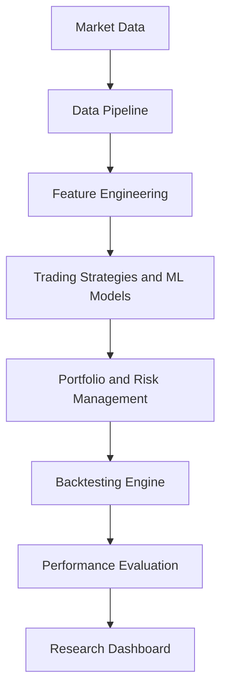

# QuantEdge

A quantitative trading research platform for systematic strategy
development, machine learning, backtesting, and portfolio optimization.

## Overview

QuantEdge is an independent quantitative finance research project
designed to explore the intersection of software engineering,
machine learning, and computational investing.

The platform aims to develop, evaluate, and compare systematic
trading strategies using historical financial data, rigorous
statistical analysis, and realistic market simulations.

## Project Objectives

- Build a reliable financial data acquisition pipeline.
- Develop quantitative indicators and financial features.
- Implement a custom backtesting engine.
- Evaluate rule-based and machine learning trading strategies.
- Optimize portfolio allocation and manage investment risk.
- Compare strategy performance against market benchmarks.
- Generate actionable research insights through visualization.

## Planned System Architecture



## Technology Stack

| Component | Technology |
|---|---|
| Programming Language | Python 3.12 |
| Data Processing | NumPy, Pandas |
| Market Data | yfinance |
| Visualization | Matplotlib |
| Machine Learning | Scikit-learn (planned) |
| Dependency Management | uv |
| Automated Testing | Pytest |
| Code Quality | Ruff |
| Continuous Integration | GitHub Actions |
| Development Environment | GitHub Codespaces |

## Getting Started

### Prerequisites

- Git
- uv
- Python 3.12 (managed by uv)

### Installation

```bash
git clone https://github.com/Marcelo916/quant-edge.git
cd quant-edge
uv python install 3.12
uv sync --locked
```

### Development and Testing

```bash
uv run ruff check .
uv run ruff format --check .
uv run pytest
```

## Research Methodology

QuantEdge prioritizes reproducibility, statistical rigor, and
realistic strategy evaluation.

The research methodology will incorporate:

- Chronological training and testing splits.
- Walk-forward validation.
- Prevention of look-ahead bias and data leakage.
- Transaction costs and market slippage.
- Out-of-sample strategy evaluation.
- Risk-adjusted performance metrics.
- Benchmark comparisons.

## Development Roadmap

- [x] Phase 0: Engineering infrastructure
- [ ] Phase 1: Financial data pipeline
- [ ] Phase 2: Quantitative financial analysis
- [ ] Phase 3: Custom backtesting engine
- [ ] Phase 4: Rule-based trading strategies
- [ ] Phase 5: Machine learning strategies
- [ ] Phase 6: Portfolio optimization and risk management
- [ ] Phase 7: Dashboard and paper trading
- [ ] Phase 8: Advanced quantitative research

## Project Status

Early development. Trading strategies and financial models
are not yet implemented or validated.

## Disclaimer

QuantEdge is intended for educational and research purposes.
It does not constitute financial or investment advice.
Historical performance does not guarantee future results.

## License

This project is licensed under the MIT License.
See the [LICENSE](LICENSE) file for details.
